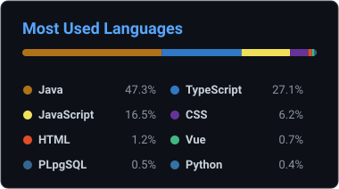

## Nguyễn Hải Dương (Tony)

Backend developer working in Java and Spring Boot. I study software development at FPT University in Ho Chi Minh City and build services, queues and the tools around them.

[Portfolio](https://tonyduongg.github.io/Portfolio/) · [LinkedIn](https://www.linkedin.com/in/tonyduongg) · [Email](mailto:nguyenhaiduong052005@gmail.com) · [Facebook](https://www.facebook.com/haiduong205)

## Projects

### Public

**[Creator Studio](https://github.com/TonyDuongg/tiktok-content-intelligence)** · Java 21, Spring Boot 3, PostgreSQL, Redis, AWS SQS and S3 
Reads public TikTok channels, ranks their videos by engagement and writes three-part short-video scripts: a 3-second hook, the body and a call to action. Script jobs run through AWS SQS; a job that fails lands in a dead-letter queue and refunds its credits. Ships as a Windows desktop app ([v1.1.0](https://github.com/TonyDuongg/tiktok-content-intelligence/releases/latest)).

**[agent-redact](https://github.com/TonyDuongg/agent-redact)** · TypeScript, Node.js, Python, MCP 
A local secret and PII redactor for AI agents and LLMs. It masks API keys, database URLs and personal data before a prompt leaves the machine, and can restore them in the answer, including while the Anthropic or OpenAI SDK streams it. Comes as a CLI, an MCP server, a proxy that needs no code changes, Express middleware and a GitHub Action, with a dependency-free core. Published as 0.5.0 on [npm](https://www.npmjs.com/package/agent-redact) and PyPI. [Try it in the browser](https://tonyduongg.github.io/Portfolio/#redact).

**[Tiến Lên](https://mien-nam-30-4.vercel.app)** · JavaScript, CSS, Canvas 
A browser game for 30 April: drive from Hà Nội to Dinh Độc Lập through seven stops and answer a timed history question at each one. [Source](https://github.com/TonyDuongg/Mien_Nam_30_4).

**[Portfolio](https://tonyduongg.github.io/Portfolio/)** · React, TypeScript, Vite 
My site, rendered to static HTML at build time and deployed to GitHub Pages by a workflow. [Source](https://github.com/TonyDuongg/Portfolio).

### Private, demo on request

**AppFinance** · Java 21, Spring Boot 4, React 19, PostgreSQL, Docker, Railway, GitHub Actions 
Finance and reconciliation across shops for Shopee and TikTok Shop sellers: OAuth connections with tokens encrypted using AES-256-GCM, incremental order sync every 15 minutes, payout reconciliation, profit and loss per shop, Excel and CSV export, and an AI assistant that answers questions about the numbers. In production since July 2026.

**RugMaxing Studio** · Node.js, Express, Telegraf, React, Vite, SQLite, Cloudflare R2, n8n 
A Telegram bot, a web studio and an admin panel for creating and editing rug designs with AI. Telegram login verified with HMAC, quota packages with a ledger and idempotency, SePay payments by webhook, uploads to Cloudflare R2 through presigned URLs, image processing in n8n.

**PRJ301 User Management** · Java, Servlet/JSP, SQL Server, Tomcat 
An MVC web app with login, admin and user roles, user search and CRUD, and a shopping cart, with data access through DAO and DTO layers.

## Tools, and where I used them

| Area | Tools | Used in |
| :--- | :--- | :--- |
| Languages | Java, TypeScript, JavaScript, Python | everything above |
| Backend | Spring Boot, Node.js, Express, REST APIs | AppFinance, Creator Studio, RugMaxing Studio |
| Data | PostgreSQL, Redis, SQL Server, SQLite | AppFinance, Creator Studio, PRJ301, RugMaxing Studio |
| Cloud and delivery | AWS SQS and S3, Docker, Railway, Cloudflare R2, GitHub Actions | Creator Studio, AppFinance, RugMaxing Studio |
| AI | Gemini, AWS Bedrock, MCP | Creator Studio, agent-redact |
| Frontend | React, Vite | AppFinance, RugMaxing Studio, Portfolio |
| Also worked with | MySQL, Tailwind CSS, Git, Postman, Swagger | |
| Learning next | AWS architecture, Next.js | |

## Activity

<picture>
  <source media="(prefers-color-scheme: dark)" srcset="https://raw.githubusercontent.com/TonyDuongg/TonyDuongg/output/snake-tonyd-dark.svg" />
  <source media="(prefers-color-scheme: light)" srcset="https://raw.githubusercontent.com/TonyDuongg/TonyDuongg/output/snake-tonyd-light.svg" />
  
</picture>

The language card and the snake are redrawn every day at 00:00 UTC by [profile-updater.yml](.github/workflows/profile-updater.yml).
