<a href="https://tonyduongg.github.io/Portfolio/"><picture><source media="(prefers-color-scheme: dark)" srcset="assets/cards/dark/header.svg" /></picture></a>

  <a href="https://tonyduongg.github.io/Portfolio/"><picture><source media="(prefers-color-scheme: dark)" srcset="assets/cards/dark/link-portfolio.svg" /></picture></a>
  <a href="https://www.linkedin.com/in/tonyduongg"><picture><source media="(prefers-color-scheme: dark)" srcset="assets/cards/dark/link-linkedin.svg" /></picture></a>
  <a href="mailto:nguyenhaiduong052005@gmail.com"><picture><source media="(prefers-color-scheme: dark)" srcset="assets/cards/dark/link-email.svg" /></picture></a>
  <a href="https://www.facebook.com/haiduong205"><picture><source media="(prefers-color-scheme: dark)" srcset="assets/cards/dark/link-facebook.svg" /></picture></a>

  <picture><source media="(prefers-color-scheme: dark)" srcset="assets/cards/dark/now.svg" />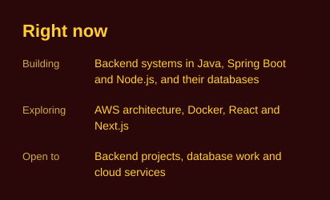</picture>
  <picture><source media="(prefers-color-scheme: dark)" srcset="assets/cards/dark/principles.svg" />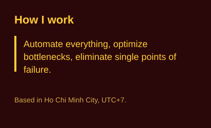</picture>

### Featured work

  <a href="https://github.com/TonyDuongg/tiktok-content-intelligence"><picture><source media="(prefers-color-scheme: dark)" srcset="assets/cards/dark/project-creator-studio.svg" />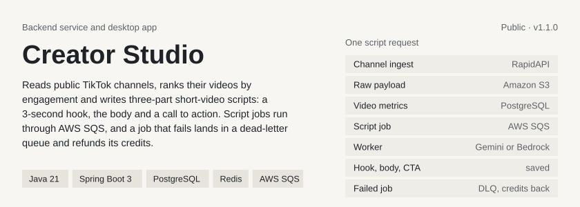</picture></a>

  <a href="https://github.com/TonyDuongg/agent-redact"><picture><source media="(prefers-color-scheme: dark)" srcset="assets/cards/dark/project-agent-redact.svg" />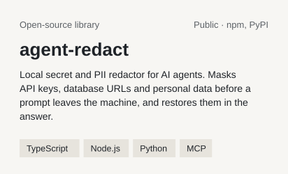</picture></a>
  <picture><source media="(prefers-color-scheme: dark)" srcset="assets/cards/dark/project-appfinance.svg" />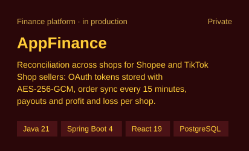</picture>

  <picture><source media="(prefers-color-scheme: dark)" srcset="assets/cards/dark/project-rugmaxing.svg" />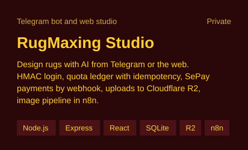</picture>
  <a href="https://mien-nam-30-4.vercel.app"><picture><source media="(prefers-color-scheme: dark)" srcset="assets/cards/dark/project-tien-len.svg" />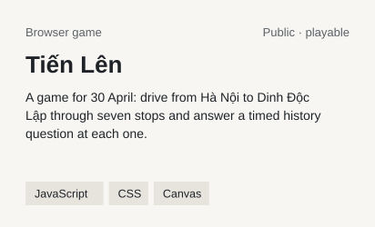</picture></a>

  <a href="https://tonyduongg.github.io/Portfolio/"><picture><source media="(prefers-color-scheme: dark)" srcset="assets/cards/dark/project-portfolio.svg" />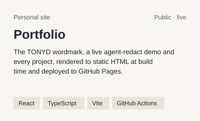</picture></a>
  <picture><source media="(prefers-color-scheme: dark)" srcset="assets/cards/dark/project-prj301.svg" />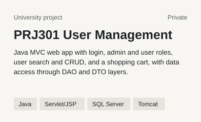</picture>

Private projects can be demoed on request.

### Stack

  <picture><source media="(prefers-color-scheme: dark)" srcset="assets/cards/dark/stack.svg" />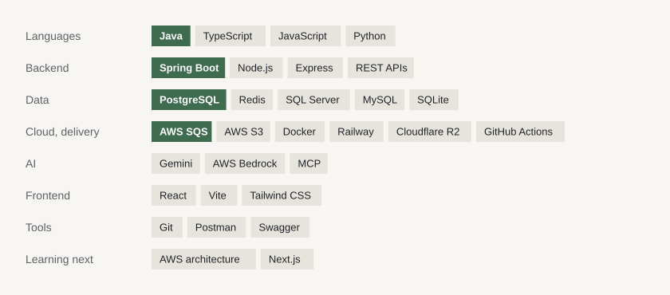</picture>

### Activity

  <picture><source media="(prefers-color-scheme: dark)" srcset="https://github-stats-extended.vercel.app/api?username=TonyDuongg&show_icons=true&include_all_commits=true&bg_color=17181b&title_color=e8e6e1&text_color=e8e6e1&icon_color=8fbf9f&ring_color=8fbf9f&hide_border=true&border_radius=0&disable_animations=true" /></picture>
  <picture><source media="(prefers-color-scheme: dark)" srcset="https://raw.githubusercontent.com/TonyDuongg/TonyDuongg/output/top-langs-dark.svg" /></picture>

<picture>
  <source media="(prefers-color-scheme: dark)" srcset="https://raw.githubusercontent.com/TonyDuongg/TonyDuongg/output/snake-tonyd-dark.svg" />
  <source media="(prefers-color-scheme: light)" srcset="https://raw.githubusercontent.com/TonyDuongg/TonyDuongg/output/snake-tonyd-light.svg" />
  
</picture>

The cards are built by <a href="scripts/build_readme_cards.py">build_readme_cards.py</a>; the language card and the snake are redrawn every day at 00:00 UTC by <a href=".github/workflows/profile-updater.yml">profile-updater.yml</a>.

